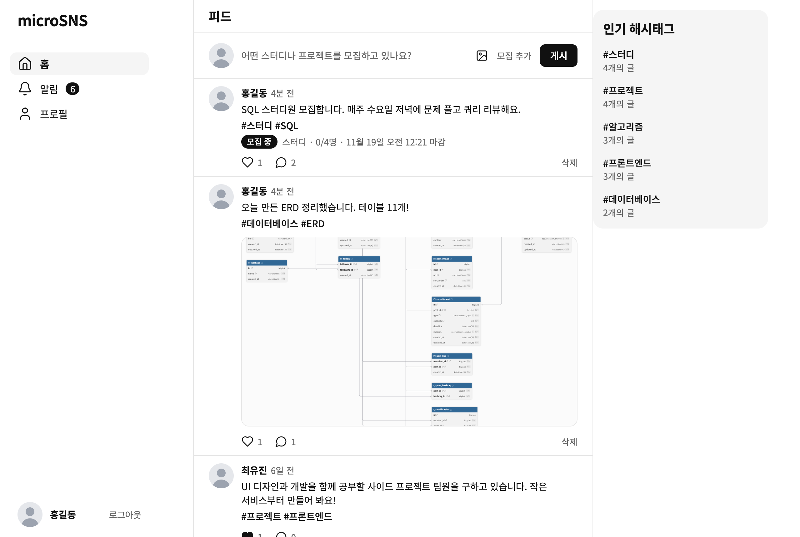
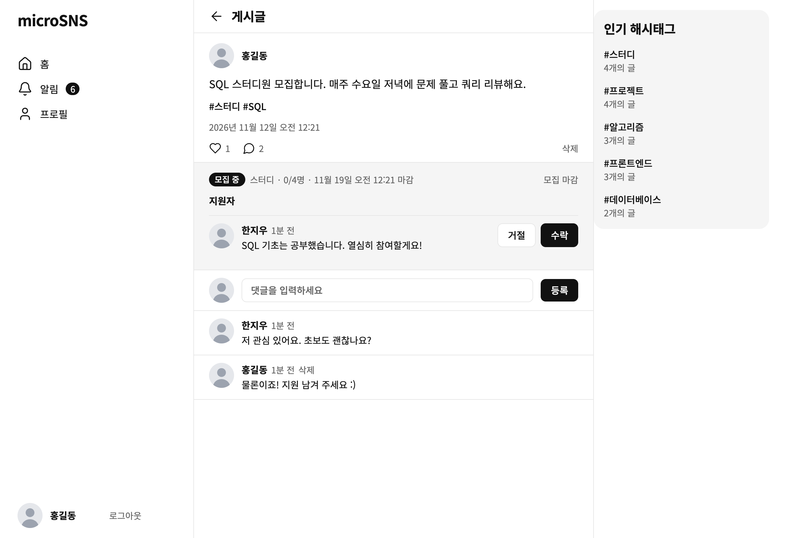
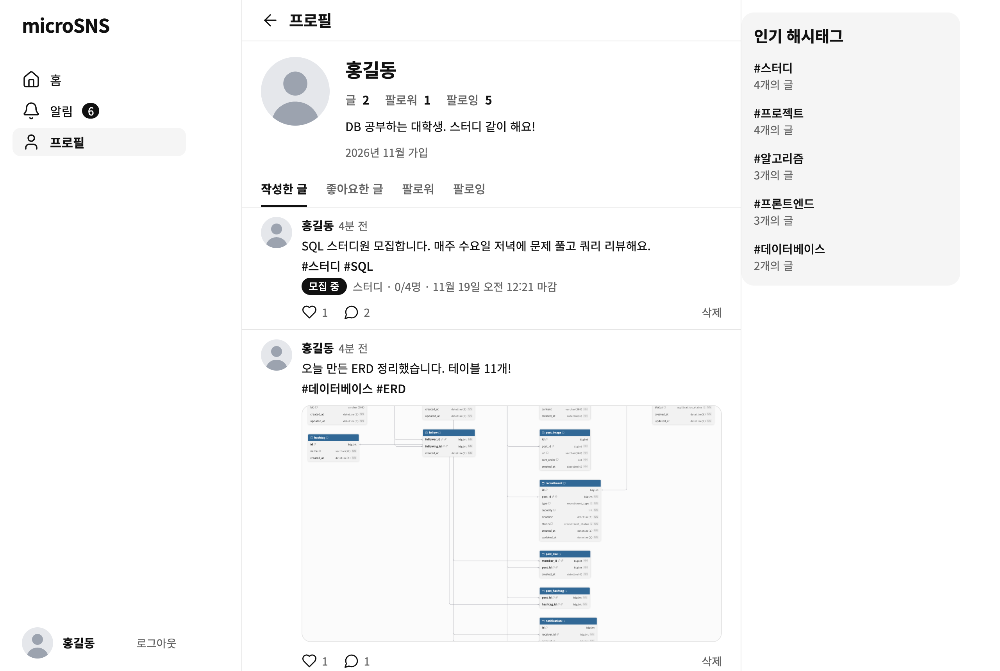
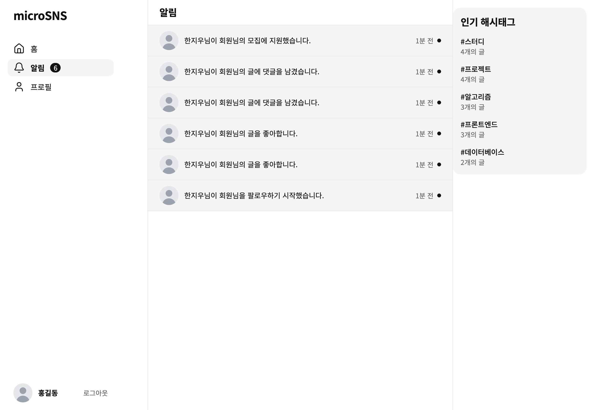
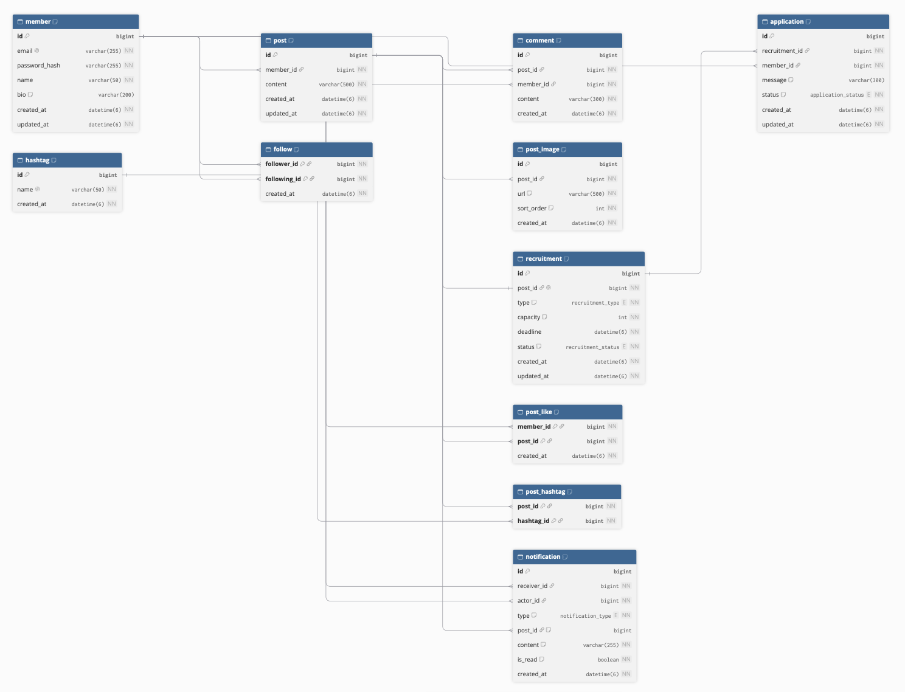

# Mini Twitter

팀 프로젝트로 만든 미니 트위터다. 글 쓰기(사진, 해시태그), 댓글, 좋아요, 팔로우, 알림이 있고 글에 모집 글을 달아 지원을 받을 수도 있다.

## 화면

| 홈 피드 | 글 상세 |
| --- | --- |
|  |  |

| 프로필 | 알림 |
| --- | --- |
|  |  |

## 주요 기능

- **회원**: 이메일로 회원가입, 로그인, 로그아웃
- **글**: 500자까지 쓰고 사진을 2장까지 붙인다(장당 5MB 이하). 본인 글만 지울 수 있다.
- **피드**: 내 글과 내가 팔로우한 회원의 글을 최신순으로 보여준다.
- **댓글, 좋아요**: 글에 댓글을 달거나 좋아요를 누르고 취소한다.
- **팔로우**: 다른 회원을 팔로우하고 팔로워, 팔로잉 목록을 본다.
- **프로필**: 회원이 쓴 글과 좋아요한 글을 본다.
- **해시태그**: 본문의 `#단어`가 해시태그로 저장된다. 대소문자는 구분하지 않는다. 인기 해시태그와 해시태그별 글 목록을 볼 수 있다.
- **모집**: 글에 스터디나 프로젝트 모집(인원, 마감일)을 붙인다. 다른 회원이 지원하면 작성자가 수락하거나 거절하고, 모집을 마감할 수 있다. 지원자는 지원을 취소할 수 있다.
- **알림**: 좋아요, 댓글, 팔로우, 지원, 지원 결과를 알림으로 받는다. 안 읽은 알림 수를 보여주고 읽음 처리를 한다.

## 기술 스택

- Frontend: Next.js 16, React 19, TypeScript
- Backend: FastAPI (Python), PyMySQL
- DB: MySQL 8.0.16 이상
- 인증: JWT 쿠키, 비밀번호는 Argon2로 해싱
- 테스트: pytest


## DB 설계



테이블은 11개다. DDL은 [`db/01_schema.sql`](db/01_schema.sql)에 있다.

| 테이블 | 내용 |
| --- | --- |
| member | 회원 (이메일 UNIQUE) |
| follow | 팔로우 관계. (follower_id, following_id) 복합 PK, 자기 자신은 팔로우할 수 없다 |
| post | 게시글 |
| post_image | 글에 붙은 사진. 글 안에서 순서(sort_order)가 겹치지 않는다 |
| comment | 댓글 |
| post_like | 좋아요. (member_id, post_id) 복합 PK |
| hashtag | 해시태그 이름 (UNIQUE) |
| post_hashtag | 글과 해시태그의 다대다 연결 |
| recruitment | 글에 붙는 모집. 글 하나에 하나만 붙는다 |
| application | 모집 지원. 같은 모집에 두 번 지원할 수 없다 |
| notification | 알림. 팔로우 알림은 글이 없어서 post_id가 NULL이다 |

테이블별 함수 종속성과 1NF~3NF 확인은 [`docs/normalization.md`](docs/normalization.md)에 정리했다.

## 실행 방법

MySQL 8.0.16 이상, Python 3, Node.js가 설치되어 있어야 한다. 아래 순서대로 하면 로컬에서 실행된다.

### 1. 레포 받기

```bash
git clone https://github.com/wo-gml/MicroSNS.git
cd MicroSNS
```

### 2. DB 만들기

레포 루트에서 DB를 만들고 스키마와 시드를 넣는다. 시드는 회원 → 게시글 → 해시태그 순서로 넣어야 한다.

macOS / Linux

```bash
mysql -u root -p -e "CREATE DATABASE microsns CHARACTER SET utf8mb4"
cat db/01_schema.sql db/seed/members.sql db/seed/posts.sql db/seed/hashtags.sql | mysql -u root -p microsns
```

Windows (명령 프롬프트)

```bat
mysql -u root -p -e "CREATE DATABASE microsns CHARACTER SET utf8mb4"
type db\01_schema.sql db\seed\members.sql db\seed\posts.sql db\seed\hashtags.sql | mysql -u root -p microsns
```

- `Enter password:`가 뜨면 MySQL을 설치할 때 정한 root 비밀번호를 입력한다. 입력해도 화면에 아무것도 안 보이는데 정상이다.
- `01_schema.sql`은 테이블을 지우고 다시 만들기 때문에 다시 실행하면 데이터가 사라진다.
- 시드 회원으로는 로그인할 수 없다. 화면을 볼 때는 회원가입해서 쓴다.
- Windows는 PowerShell 말고 명령 프롬프트(cmd)에서 실행한다. PowerShell은 파이프로 넘길 때 한글이 깨질 수 있다.

### 3. 백엔드 실행

macOS / Linux

```bash
cd backend
python3 -m venv .venv
source .venv/bin/activate
pip install -r requirements.txt
cp .env.example .env
```

Windows (명령 프롬프트)

```bat
cd backend
python -m venv .venv
.venv\Scripts\activate
pip install -r requirements.txt
copy .env.example .env
```

`.env`에서 두 값은 꼭 채운다. `DB_PASSWORD`는 2단계에서 입력한 비밀번호다. `.env`는 git에 올리지 않는다.

```env
DB_PASSWORD=MySQL_root_비밀번호
JWT_SECRET=아래_명령으로_만든_값
```

```bash
python -c "import secrets; print(secrets.token_urlsafe(48))"   # JWT_SECRET 만들기
uvicorn app.main:app --reload
```

- http://localhost:8000/docs 에서 Swagger로 API를 볼 수 있다.
- http://localhost:8000/health 로 DB 연결을 확인한다. `DB_PASSWORD`가 틀리면 API가 503(`DB_UNAVAILABLE`)을 돌려준다.

### 4. 프론트엔드 실행

새 터미널을 열고 레포 루트에서 실행한다. Windows는 `cp` 대신 `copy`를 쓴다.

```bash
cd frontend
npm install
cp .env.example .env.local
npm run dev
```

http://localhost:3000 에 접속해서 회원가입하면 된다.

테스트 실행 방법과 백엔드 코드 규칙은 [`backend/README.md`](backend/README.md)에 정리했다. 서버에 배포하는 방법은 [`deploy/README.md`](deploy/README.md)에 있다.

## 폴더 구조

```text
.
├── backend/
│   ├── app/
│   │   ├── main.py          # 앱 생성, 라우터 등록
│   │   ├── db.py            # DB 연결, 트랜잭션
│   │   ├── security.py      # 비밀번호 해싱, JWT
│   │   ├── routers/         # API
│   │   ├── repositories/    # SQL 쿼리
│   │   └── schemas/         # 요청/응답 모델
│   ├── tests/
│   └── requirements.txt
├── frontend/
│   └── src/
│       ├── app/
│       │   ├── (auth)/      # 로그인, 회원가입
│       │   └── (main)/      # 피드, 글 상세, 프로필, 해시태그, 알림
│       ├── api/             # 백엔드 호출
│       ├── components/
│       └── hooks/
├── db/
│   ├── 01_schema.sql        # 테이블 생성
│   └── seed/                # 예시 데이터 (테이블 담당자별로 파일 분리)
├── deploy/                  # 오라클 클라우드 서버 배포 스크립트와 설정
└── docs/
    ├── erd/erd.png
    ├── requirements.md      # 기능 명세
    ├── normalization.md     # 정규화
    └── presentation/        # 발표 자료
```

`backend/app`에는 이 밖에 `config.py`, `deps.py`, `errors.py`, `pagination.py`가 있다. 파일별 역할은 `backend/README.md`에 있다.

## 팀원 역할

| 이름 | 역할 |
| --- | --- |
|  |  |
